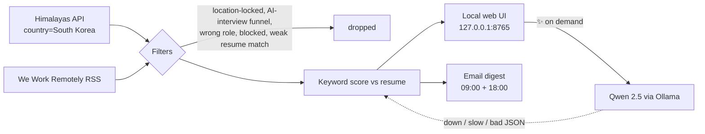

# remote-job-finder

[](https://github.com/amanuel1271/remote-job-finder/actions/workflows/ci.yml)


Finds remote backend jobs that someone outside the US can actually take, ranks them against your resume, and emails you twice a day.

Most "remote" job boards are full of postings that quietly say *must reside in the US* or *European time zones only*. This tool reads every posting, drops those, and keeps only jobs that are open to your country **and** match your resume.

- **One file, standard library only.** No pip install.
- **Local AI, on demand.** Click ✨ on a job and a local Qwen model (via Ollama) scores it against your resume. If the model is down, a keyword score is used instead.
- **Learns from you.** Block a company or a phrase once and it never shows up again.

## How it works



### Filters

| A job is dropped when… | How it's detected |
|---|---|
| it isn't open to your country | Himalayas `locationRestrictions`; WWR region **and** country list (an "Anywhere" label with an EU-only country list is caught) |
| the title names a region ("Remote Europe", "US only") | title regex, unless the title also says worldwide |
| the posting is location-locked | whole-word phrases like *must reside in the US*, *US hours*, *security clearance*; negated mentions ("no US citizenship required") don't count |
| the hiring funnel uses an AI interviewer | phrases like *AI interview*, *AI screening* |
| it's the wrong role | title allow/deny lists with word boundaries ("Internal Platform Engineer" isn't an internship) |
| it barely matches your resume | must mention at least 3 of your skills, including one core language |
| you blocked the company or a phrase | `rules.json`, editable from the UI |

### Scores

- **Keyword score (instant, always):** half "few skills you lack", half "how much of your resume it mentions". Words that are also English words (Go, React, Rust, Spring) use stricter patterns, so "we react swiftly" doesn't count as React.
- **AI score (on demand):** Qwen returns `{score, why, missing}`. The output is validated, and cached per job + resume fingerprint, so editing your resume or a reposted job triggers a rescore.

## Setup (macOS)

```bash
git clone https://github.com/amanuel1271/remote-job-finder ~/job-search && cd ~/job-search
cp resume.example.txt resume.txt         # then paste your own resume text
python3 jobs.py --test                   # self-check
python3 jobs.py --ui                     # opens http://127.0.0.1:8765
```

Optional pieces:

| Piece | How |
|---|---|
| **AI scoring** | Install [Ollama](https://ollama.com), then `ollama pull qwen2.5:3b`. On macOS 13, use Ollama v0.9.6 (newer builds need macOS 14). |
| **Email digest** | Create a free [Resend](https://resend.com) API key, store it in Keychain: `security add-generic-password -s job-finder-resend -a you@example.com -w` |
| **Twice-daily schedule** | Edit the paths and email in `launchd/com.example.jobfinder.plist`, copy it to `~/Library/LaunchAgents/`, then `launchctl bootstrap gui/$(id -u) ~/Library/LaunchAgents/com.example.jobfinder.plist` |

Change the country, skills and thresholds at the top of `jobs.py` (`HIMALAYAS_QUERIES`, `MY_SKILLS`, `CORE_SKILLS`, `MIN_SKILL_MATCHES`).

## Commands

| Command | What it does |
|---|---|
| `python3 jobs.py --ui` | Local web UI: search, sort by match, ✨ AI match, mark seen, block company/phrase |
| `python3 jobs.py` | Terminal list of new jobs, then asks which were bad and learns from it |
| `python3 jobs.py --digest` | Emails new jobs (what the schedule runs) |
| `python3 jobs.py --test` | Self-check of filters, scoring and parsing |

## Reliability and safety

- **At most 2 emails a day.** The slot is reserved *before* sending, so a send that times out still counts, and each digest carries an idempotency key.
- **Crash-safe state.** Every JSON file is written atomically, so a crash can't leave a corrupt file.
- **Partial failures are isolated.** One bad item skips that item; one dead source doesn't stop the others.
- **The local UI only talks to itself.** It's bound to 127.0.0.1, checks `Host` and `Origin` (blocking DNS rebinding and cross-site requests), requires JSON, and validates every body. Job text is rendered as text, and links must be `http(s)`.

## Privacy

Your resume, blocked companies, seen and scored jobs, and logs are all in `.gitignore`. AI scoring runs on your machine; your resume is never sent anywhere.
